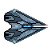
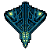
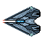

<h1 align="center">
  
        War's Plane: Sky Combat
</h1>

### Welcome to "War's Plane: Sky Combat"! 🚀🌌

"War's Plane" is an exciting airplane shooting game written in C++ using the SDL2 library. Experience intense aerial battles, defeat enemies, and challenge the boss with unique skills and bullet patterns!

[▶️ Video Demo](https://www.youtube.com/watch?v=eDS8nbxLrMA)

---

## 1. General Description

### Game Objects

-  **Player:** Move with arrow keys (↑ ↓ ← →), shoot with SPACE. Dodge enemy and boss bullets!
-  **Enemy (Obstacle):** Randomly spawned, destroyed by your bullets.
-  **Boss:** The final challenge! Moves vertically, fires bullets, and has a health bar.
-   **Bullets:** Both player and boss fire bullets. Player bullets go right, boss bullets go left.
-  **Lives:** You start with 3 lives. Lose one if hit by an enemy, boss bullet, or after missing 4 shots.

### Level Selection & Difficulty

- After clicking **Play**, you can choose your level:
  - **Easy:** Slower enemies and boss, less boss health.
  - **Medium:** Balanced challenge.
  - **Hard:** Fast enemies, boss fires rapidly, more health.
- Each level changes enemy speed, boss speed, and boss bullet speed for a unique experience.

### How to Play

- Click **Play** to start, then select your level.
- Move with arrow keys, shoot with SPACE.
- Hold **SPACE** to fire continuously.
- Press **1–4** to switch between Normal, Laser, Missile, and Spread weapons.
- Press **U** to spend 500 points on a weapon upgrade (up to level 5).

- Destroy enemies for +100 points each.
- Survive and defeat the boss to win!
- Game ends when you lose all lives.
---
## 2. Project Structure

```
Plane-Game/
│
├── src/
│   ├── main.cpp
│   ├── Game.cpp
│   ├── Game.h
│   ├── Control.cpp
│   ├── Config.h
│   ├── Resources.cpp
│   ├── BulletObject/
│   │   ├── Bullet.cpp
│   │   ├── Bullet.h
│   ├── ObstacleObject/
│   │   ├── Obstacle.cpp
│   │   ├── Obstacle.h
│   ├── ExplosionObject/
│   │   ├── ExplosionObject.cpp
│   │   ├── ExplosionObject.h
│   ├── BossObject/
│   │   ├── BossObject.cpp
│   │   ├── BossObject.h
│   ├── PowerUpObject/
│   ├── WeaponObject/
│   ├── SaveSystem/
│   ├── AchievementSystem/
│   ├── LeaderboardSystem/
│   └── include/
│       └── SDL2/

```
## 3. Main Game Components

- **Game.cpp:** Main game loop and logic.
- **Control.cpp:** Handles user input and game events.
- **Bullet.cpp:** Manages player bullets and collisions.
- **BossObject.cpp:** Boss logic, movement, and boss bullets.
- **ObstacleObject.cpp:** Enemy (obstacle) logic.
- **ExplosionObject.cpp:** Handles explosion effects.
- **Resources.cpp:** Loads assets, sounds, fonts, menus, and HUD elements.
- **Config.h:** Shared screen and frame-rate configuration.
- **SaveSystem / AchievementSystem / LeaderboardSystem:** Persistent progression and score data.

---

## 4. Download & Run

- Download the `.zip` file and extract it.
- Run `PlaneGame.exe` to start the game.
- Make sure you have all required DLLs (SDL2, SDL2_image, SDL2_ttf, SDL2_mixer) in the same folder.

---

## 5. Programming Techniques

- **C++ OOP:** Classes, structs, vectors, encapsulation.
- **SDL2:** Graphics, sound, fonts, and input handling.
- **Game Loop:** Real-time update and render.
- **Collision Detection:** For bullets, enemies, and boss.
- **Resource Management:** Efficient loading and freeing of textures, sounds, and fonts.
- **Modular Code:** Each game component in its own file.

---

## 6. References

- [Lazyfoo SDL2 Tutorials](https://lazyfoo.net/tutorials/SDL/)
- [SDL2 Documentation](https://wiki.libsdl.org/)

---

Enjoy the game and challenge yourself at every level!
